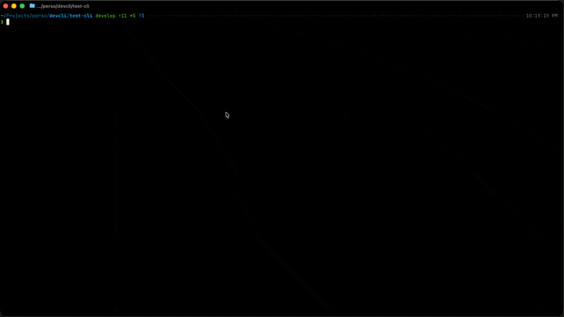
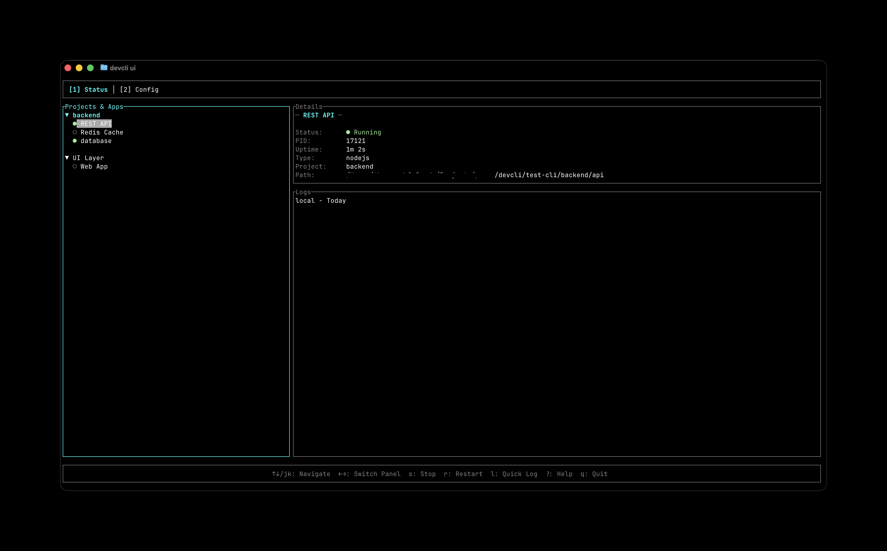
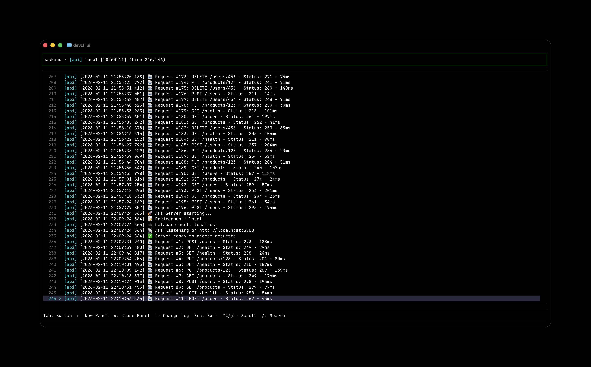
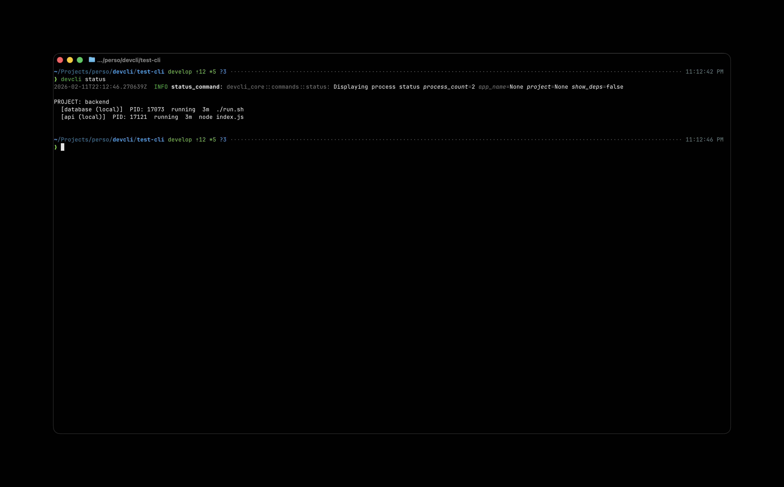

# DevCLI

Powerful process management CLI for developers. Manage multiple processes with automatic restarts, health checks, and a beautiful terminal UI.



## Showcase

### Interactive TUI Dashboard
Monitor all your processes in real-time.


### Multi-App Log Streaming
Watch logs from multiple apps simultaneously.


### Colorful CLI Status
Get quick insights into your process health.


## Installation

### Quick Install (recommended, macOS & Linux)

```bash
curl -fsSL https://raw.githubusercontent.com/xDelph/devcli/develop/install.sh | sh
```

This installs both `devcli` and its background daemon `pm-daemon` into `~/.devcli/bin`.

### Homebrew

```bash
brew tap xDelph/devcli
brew install devcli
```

### Build from source

```bash
cargo build --release --workspace
# binaries: target/release/devcli and target/release/pm-daemon
```

## Getting Started

### 1. Initialize Configuration

Create a configuration file in `~/.devcli/config.json`:

```bash
devcli config init
```

This writes an empty configuration (`{"projects": {}}`) and prints an example
project you can copy into it. It refuses to overwrite an existing file.

### 2. Edit Configuration

Edit your config file:

```bash
devcli config edit
```

Example configuration structure:

```json
{
  "projects": {
    "my-project": {
      "alternative_name": "ProjectX",
      "apps": {
        "api": {
          "type": "nodejs",
          "alternative_name": "Backend",
          "path": "~/Projects/my-project/api",
          "commands": {
            "local": {
              "start": "npm start",
              "test": "npm test",
              "build": "npm run build"
            },
            "docker": {
              "build": "docker build -t my-api .",
              "run": "docker run --name my-api -p 3000:3000 --rm my-api"
            }
          },
          "dependencies": [],
          "defaults": {
            "local": "start",
            "docker": "run"
          }
        }
      }
    }
  }
}
```

### 3. Validate Configuration

Check your configuration is valid:

```bash
devcli config validate
```

### 4. Set Preferences

Set your default environment (`local`, `docker`, `orbstack`, `docker-compose`,
`k8s` or `ci`):

```bash
devcli pref set default-env local
```

## Usage

### Starting Processes

Start a process using its default command:

```bash
devcli start api
```

Start with a specific environment:

```bash
devcli start api --env docker
```

If app names are ambiguous across projects, specify the project:

```bash
devcli start api --project my-project
```

You can also use alternative names (configured via `alternative_name` field):

```bash
devcli start Backend  # Uses alternative_name instead of real name
```

### Running Specific Commands

Run a specific command variant:

```bash
devcli run api build
devcli run api test
```

With environment override:

```bash
devcli run api build --env docker
```

### Checking Status

View all running processes grouped by project:

```bash
devcli status
```

Filter by project:

```bash
devcli status --project my-project
```

Show a specific app with its dependencies:

```bash
devcli status api --deps
```

Example output:

```
PROJECT: my-project
  [api (local) [start]]  PID: 12345  running  2h 15m  npm start
  [worker (local) [start]]  PID: 12346  running  1h 30m  npm run worker

PROJECT: other-project
  [frontend (local) [dev]]  PID: 12347  running  45m  npm run dev
```

Each line shows the app, its environment and the command that runs. `status`
exits with code 1 when no tracked process is running, and fails on an app name
that is neither configured nor running.

### Configuration Management

List all projects and apps:

```bash
devcli config list
```

List apps only:

```bash
devcli config list --apps-only
```

Show details of a specific app:

```bash
devcli config show api
```

### Preferences Management

Show current preferences:

```bash
devcli pref show
```

Set default environment:

```bash
devcli pref set default-env docker
```

Reset preferences to defaults:

```bash
devcli pref reset
```

## Git worktrees

Agent harnesses give every sub-agent its own git worktree. devcli runs your
apps from any worktree of their repository, with nothing added to the
config:

```bash
cd ~/code/shop/.claude/worktrees/agent-1
devcli start api            # this worktree's api, on its own ports
devcli logs api             # its logs
devcli stop api             # stops it, never the main checkout's

devcli worktrees            # every worktree, its slot, branch and running apps
devcli start api@agent-1    # the same instance, from anywhere
devcli start api@           # the configured checkout, from anywhere
devcli stop api@*           # every checkout (refused under an AI agent)
```

A worktree instance is the project `shop@agent-1`: its own process, state and
log file. Worktrees are numbered (slot 1, 2, ...) and keep their number while
they exist; an app gets `DEVCLI_WORKTREE`, `DEVCLI_WORKTREE_INDEX` and
`DEVCLI_PORT_OFFSET` (slot × 100). Declare the port an app reads from `$PORT`
to have devcli shift it:

```json
{ "type": "nodejs", "path": "~/code/shop/apps/api", "port": 3000,
  "commands": { "local": { "dev": "npm run dev" } }, "defaults": { "local": "dev" } }
```

`api` then listens on 3000 in the main checkout and on 3100 in slot 1, and its
health check follows. Without `port`, a `PORT` from the app's env files is
shifted. Also handled:

- a fresh worktree has no env files (they are gitignored): the main
  checkout's are used until the worktree has its own
- dependencies in the same repository start in the same worktree; shared ones
  (a database, another repository) stay the configured instance. Each app gets
  `DEVCLI_PORT_<APP>` with the port of each dependency that declares one (for
  example `sh -c 'API_URL=http://localhost:$DEVCLI_PORT_API npm run dev'` as a
  command), so a worktree's web talks to its own api
- Docker Compose apps get a `COMPOSE_PROJECT_NAME` per worktree
- deleting a worktree stops the apps that ran from it (pm-daemon)
- `auto-add` run inside a worktree registers the main checkout's path
- the TUI lists each worktree instance under its project

## Using devcli with AI coding agents

devcli speaks JSON and returns meaningful exit codes, so an agent can drive it
without a TTY. The contract lives in [`AGENTS.md`](AGENTS.md) — but an agent
has no reason to know devcli exists, so install the rules once:

```bash
devcli install-agents --global     # every agent you use, all projects
devcli install-agents              # this project (or --local PATH)
devcli uninstall-agents --global   # remove them again
```

Each agent reads its own files, so devcli writes where they actually look.

`--global` writes a short block, pointing at the full rules in
`~/.devcli/AGENTS.md`, for each agent whose directory exists (`--agent NAME`
picks them explicitly):

| Agent | User-level file |
|-------|-----------------|
| Claude Code (`claude`) | `~/.claude/CLAUDE.md` |
| Codex (`codex`) | `~/.codex/AGENTS.md` (honours `CODEX_HOME` and `AGENTS.override.md`) |
| Gemini CLI (`gemini`) | `~/.gemini/GEMINI.md` |
| Cursor (`cursor`) | `~/.cursor/rules/devcli.mdc`, an always-applied rule file of its own |
| pi (`pi`) | `~/.pi/agent/AGENTS.md` (honours `PI_CODING_AGENT_DIR` and `AGENTS.override.md`) |
| OpenCode (`opencode`) | `~/.config/opencode/AGENTS.md` |
| Devin CLI (`devin`) | `~/.config/devin/AGENTS.md` (Windows: `%APPDATA%\devin\AGENTS.md`) |

The block is short on purpose: those files load into every session of every
project.

In a project, the full rules go into `AGENTS.md`, which Codex, Cursor, OpenCode,
Devin, pi, Copilot and Claude Code read. Two agents get an import of it in their
own file:

- `CLAUDE.md` (or `.claude/CLAUDE.md`), when the project has one: Claude Code
  then ignores `AGENTS.md`.
- `GEMINI.md`, when the project has one or Gemini CLI is installed: Gemini CLI
  reads `GEMINI.md`, not `AGENTS.md`.

Agents are told to act on the apps they work on, by name, and devcli enforces
the part that matters: when it detects it runs under an AI agent (from the
variables agent harnesses set, such as `CLAUDECODE`, `CODEX_SANDBOX`,
`GEMINI_CLI`, `CURSOR_AGENT`), it refuses `stop --all`, `stop --project P`
without an app and `APP@*` (every worktree) for `start` and `stop`, which would
also reach what you and other agents run. Under an agent, `start`, `restart`
and `run` also always return right away instead of staying attached.
`DEVCLI_AGENT=1` turns this on for a harness devcli does not recognise,
`DEVCLI_AGENT=0` turns it off. It guards against mistakes, not against an agent
determined to kill processes.

The blocks are fenced by HTML-comment markers, so devcli can refresh or remove
them without touching your own lines; a file devcli created is deleted again on
uninstall. The previous version of every file it changes is saved under
`~/.devcli/backups/agents/`. Re-run `install-agents` after upgrading devcli to
refresh the rules.

## Features

### Config-Based Management

All processes are defined in `~/.devcli/config.json`:
- Centralized configuration for all projects and apps
- Support for multiple environments (local, docker, orbstack, docker-compose,
  k8s, ci)
- Default commands per environment
- Path expansion for home directory (~) and environment variables
- Commands are split into arguments like a shell would, but run without a
  shell: wrap pipes, `&&` or `VAR=value` prefixes in `sh -c '...'`

### Dependency Resolution

Define dependencies between apps:

```json
{
  "dependencies": [
    {"project": "infrastructure", "app": "redis"},
    {"project": "infrastructure", "app": "traefik"}
  ]
}
```

devcli will:
- Check dependencies are running before starting an app
- Detect circular dependencies
- Provide clear error messages for missing dependencies

### Multi-Environment Support

Define separate commands for different environments:
- `local`: Commands for local development
- `docker`: Commands for Docker containers
- `orbstack`: Docker commands run with the OrbStack context
- `docker-compose` (alias `compose` on the command line): Docker Compose commands
- `k8s` (alias `kubernetes` on the command line): Kubernetes commands
- `ci`: CI pipeline commands

Set your preferred environment once, or override per command.

### Project Grouping

Status command groups processes by project for better organization. Processes without config metadata are shown in "UNGROUPED" section.

### Privacy & Alternative Names

Use `alternative_name` for projects and apps to:
- Hide real names in screenshots and demos
- Use privacy-friendly names in TUI
- Start/stop apps using alternative names
- Share configuration examples publicly

```json
{
  "projects": {
    "internal-project": {
      "alternative_name": "ProjectX",
      "apps": {
        "sensitive-api": {
          "alternative_name": "Backend",
          "type": "nodejs",
          "path": "~/code/internal-project/api",
          "commands": { "local": { "start": "npm start" } },
          "defaults": { "local": "start" }
        }
      }
    }
  }
}
```

### Log Management

All process output (stdout and stderr) is saved to:
```
~/.devcli/logs/<project>_<app>_<env>_<YYYYMMDD>.log
```

Lines are written as the app prints them (devcli adds no timestamps). A file
larger than 20 MiB is copied to `<name>.log.1` and truncated. Read them with
`devcli logs APP` or the TUI. devcli's own log is
`~/.devcli/logs/devcli.json.YYYY-MM-DD` (JSON, one file per day; verbosity set
with `LOG_LEVEL`).

### Process Tracking

Process state is managed by the standalone `process-manager` crate and stored in:

```
~/.devcli/processes/<project>.<app>.<environment>.json
```

Supporting files in the same directory:

```
~/.devcli/processes/.status_changed   # mtime notification for TUI polling
~/.devcli/processes/.daemon.lock      # held by pm-daemon while running
```

Each process file includes:

- Process ID (PID) and process group (PGID)
- Command, working directory, and environment
- Start time and restart history
- Project, app, and environment metadata
- Health check and restart policy from config

Health monitoring and auto-restart run in `pm-daemon`, which must be installed alongside `devcli` (release tarballs include both binaries, which install to `~/.devcli/bin`).

## AI Agents

`devcli` is designed to be driven by autonomous agents:

```bash
devcli --json status              # machine-readable process state
devcli --json config list         # full config as JSON
devcli --json logs api -n 100     # recent app logs
devcli --json start api --detached
devcli --json auto-add --path ./apps/api --yes --project proj --name api
```

- **`--json`** on every state-reporting command (also disables console logging).
- **`--no-color`** and automatic color-off when stdout is not a TTY.
- **Meaningful exit codes**: `status` (0 running / 1 not), `health-check`
  (0 healthy / 2 unhealthy / 1 error), `config validate` (1 invalid).
- **No hanging**: under an AI agent, `start`, `restart` and `run` return right
  away; `stop --all`, whole-project stops and `@*` are refused.
- **Non-interactive mode** for `auto-add` (`--yes`, `--project`, `--name`,
  `--type`); commands fail fast instead of hanging when there is no terminal.
See **[AGENTS.md](./AGENTS.md)** for the full agent contract (flags, exit
codes, JSON shapes, non-interactive usage).

## Documentation

Comprehensive documentation is available in the `docs/` directory:

### 📚 Documentation

- **[AGENTS.md](./AGENTS.md)** - Contract for AI agents (JSON, exit codes)
- **[Getting Started](./docs/getting-started.md)** - Quick start guide with examples (5-minute setup)
- **[Configuration Reference](./docs/configuration-reference.md)** - Complete config file documentation
- **[Commands Reference](./docs/commands-reference.md)** - All CLI commands with examples
- **[Advanced Features](./docs/advanced-features.md)** - Health checks, metrics, logging, dependencies
- **[Troubleshooting](./docs/troubleshooting.md)** - Common issues and solutions

### Quick Links

- **Installation**: See [Getting Started](./docs/getting-started.md#installation)
- **Config Format**: See [Configuration Reference](./docs/configuration-reference.md#file-structure)
- **All Commands**: See [Commands Reference](./docs/commands-reference.md)
- **Health Checks**: See [Advanced Features](./docs/advanced-features.md#health-checks)
- **Metrics**: See [Advanced Features](./docs/advanced-features.md#metrics--monitoring)
- **Help**: See [Troubleshooting](./docs/troubleshooting.md)

## License

`devcli` is source-available under the [PolyForm Noncommercial License 1.0.0](./LICENSE).
Commercial use requires a paid license — see [LICENSE-COMMERCIAL.md](./LICENSE-COMMERCIAL.md)
or contact devcli@delalonde.dev.
